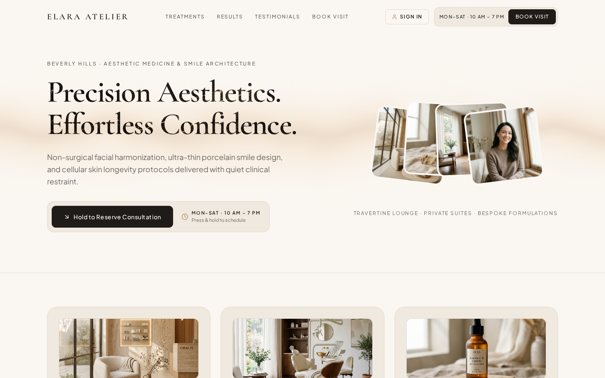
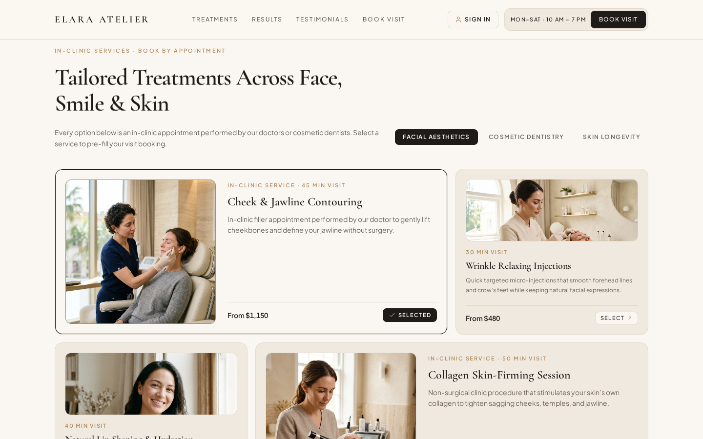
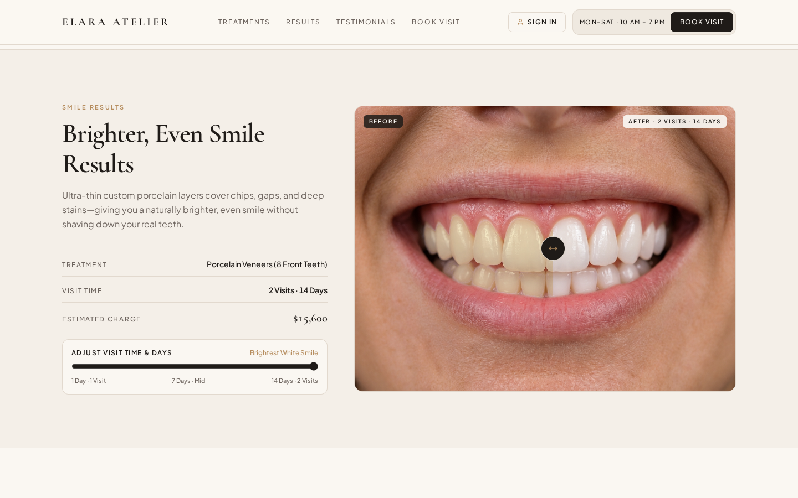
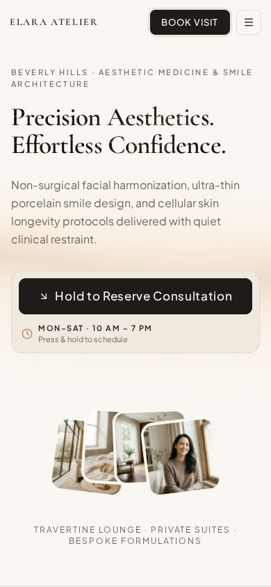

# Elara Atelier — Aesthetic & Dental Studio

> Editorial luxury platform for non-surgical facial aesthetics, ultra-thin porcelain smile design, and cellular skin longevity in Beverly Hills—built with React, TypeScript, Tailwind CSS, Express, Firebase Authentication & Firestore, and a two-way Telegram Concierge Bot.

---

## Showcase

### Studio Hero & Editorial Atmosphere
Warm minimalist travertine & alabaster aesthetic pairing masked display serif typography (`Cormorant Garamond`), `SoftAurora` WebGL ambient motion, a hold-to-reserve concierge CTA, and interactive `BounceCards` studio vignettes.



### Interactive Treatment Bento & Selection Sync
Filterable clinical service catalog (`Facial Aesthetics`, `Cosmetic Dentistry`, `Skin Longevity`) powered by `MagicBento` and `GlareHover`. Selecting any treatment highlights the service card and pre-fills the booking concierge without jarring scroll jumps.



### Teeth-Only Before & After Smile Simulator
Interactive split-frame comparison rendering from a **single unified smile photograph** with pixel-level canvas tooth masking so facial skin, lips, and gums stay identical on both sides. Adjusting the **Visit Time & Days** slider (`1 Day · 1 Visit` to `14 Days · 2 Visits`) progressively scales enamel brightness and updates the estimated treatment charge in real time.



### Private Concierge Booking & Studio Map
Validates adult (18+) patient registration via an in-website calendar (`AtelierDatePicker`), letters-only full names, country-coded phone numbers, and optional `@username` when marked as the same number as Telegram—paired with slide-to-confirm submission (`SlideCommit`), WhatsApp/Telegram coordination, and an interactive clinic map.


### Responsive Across Mobile & Ultrawide Screens
Adaptive layout scaling from narrow `360px`–`390px` phones (single-row scrollable tabs, touch-friendly controls, compact header) through `768px` tablets, `1440px` desktops, and `1920px+` ultrawide displays (`2xl:max-w-[1440px]`).

<p align="center">
  
</p>

---

## Key Capabilities

- **Patient Portal & Calendar (`AuthSection` & `ProfileSection`)**:
  - Firebase Google Sign-In (syncing patient profile avatar cleanly) and Email/Password authentication.
  - Strict 18+ Date of Birth verification, phone country-code picker (`GlideSelect`), and optional Telegram username toggle.
  - Interactive monthly schedule calendar with a **4-hour post-booking self-edit and cancellation window** enforced both in UI and `firestore.rules`.
- **Two-Way Telegram Concierge (`@ElaraAtelierBot`)**:
  - Strict per-user routing matching bookings and direct messages only to the verified user's `@username` or shared Telegram phone contact.
  - Persistent bottom Telegram Reply Keyboard (`My Appointments`, `Change Timing`, `Our Treatments`, `Clinic Hours & Address`, `Send Concierge Message`) plus inline 4-hour rescheduling and cancellation buttons.
  - Real-time Server-Sent Events (`/api/telegram/events`) and authenticated **Direct Concierge Chat** inside the Patient Profile syncing messages seamlessly between Telegram and the website.
- **Tooth-Only Canvas Retouching Engine (`src/utils/smileRetouch.ts`)**:
  - Isolates tooth enamel luminance & hue while protecting pink gingival margins and surrounding skin, producing realistic natural staining on the Before side and smooth progressive whitening on the After side.

---

## Tech Stack & Project Structure

| Layer | Technology |
| :--- | :--- |
| **Frontend** | React 19, TypeScript, Vite 8, Tailwind CSS v4, Motion (`motion/react`), Lucide & Hugeicons |
| **Backend API** | Express (`src/server/createApp.ts`) shared between Node (`server.ts`) and Vercel (`api/index.ts`) |
| **Auth & Database** | Firebase Authentication (Google + Email/Password) & Cloud Firestore (`firestore.rules`) |
| **Messaging** | Telegram Bot API (Webhook & Local Long Polling), SSE live updates, WhatsApp deep links |
| **Testing** | Node `--test` via `tsx`, `tsc --noEmit`, Vite build, and Headless Chromium (`playwright-cli`) |

```text
├── api/
│   └── index.ts                 # Vercel Serverless entry point delegating /api/* to Express
├── docs/screenshots/            # Live rendered application screenshots for documentation
├── public/                      # Static clinic media and smile photography
├── src/
│   ├── components/
│   │   ├── reactbits/           # AtelierDatePicker, BounceCards, GlareHover, GlideSelect, HoldButton, MagicBento, SlideCommit, SoftAurora
│   │   ├── sections/            # Header, HeroSection, TrustMetricsSection, TreatmentsSection, BeforeAfterSection, TestimonialsSection, BookingSection, AuthSection, ProfileSection, Footer
│   │   └── ui/                  # PatientAvatar, TelegramConciergeChat
│   ├── config/clinicConfig.ts   # Clinic constants, hours, address, country prefixes & defaults
│   ├── context/AuthContext.tsx  # Firebase Auth, Firestore sync, SSE listener & concierge chat state
│   ├── data/                    # Clinical service catalog, testimonials, trust metrics & media manifest
│   ├── server/
│   │   ├── createApp.ts         # Shared Express routes (/api/health, /api/telegram/*)
│   │   ├── conciergeStore.ts    # Strict per-user Telegram booking/chat matching & 4h rule enforcement
│   │   └── telegramBot.ts       # Bot menu keyboards, HTML push cards, /start & callback handlers
│   └── utils/                   # Form validation, 4h edit timers & canvas tooth-retouch algorithms
├── server.ts                    # Local Node & container Express + Vite server (port 3000)
└── vercel.json                  # Vercel build output (dist/) and /api/* rewrite configuration
```

---

## Local Development

### Prerequisites
- Node.js `>= 20`
- npm `>= 10`

### 1. Install Dependencies
```bash
npm install
```

### 2. Configure Environment Variables
Copy `.env.example` to `.env` and fill in optional Telegram Bot credentials (the site and Firebase features run out of the box even without a Telegram token using deep links):

```bash
cp .env.example .env
```

```env
GEMINI_API_KEY="MY_GEMINI_API_KEY"
APP_URL="http://localhost:3000"
TELEGRAM_BOT_TOKEN=""                # From @BotFather (optional)
TELEGRAM_BOT_USERNAME="ElaraAtelierBot"
TELEGRAM_CONCIERGE_CHAT_ID=""        # Optional clinic desk chat ID
TELEGRAM_USE_POLLING="true"          # true locally; set to false on Vercel
```

### 3. Run the Full-Stack Dev Server
Starts Express API routes + Vite middlewares on port `3000` (plus Telegram long-polling when `TELEGRAM_BOT_TOKEN` is set):

```bash
npm run dev
```

Open `http://localhost:3000`.

### 4. Verify Build, Types & Tests
```bash
npm run lint
npm run build
npx --yes tsx --test src/utils/booking.test.ts src/server/telegramBot.test.ts
```

---

## Deploying on Vercel

This repository is pre-configured for **Vercel** via `vercel.json` and `api/index.ts`:
- Static Vite frontend builds into `dist/` via `vite build`.
- All `/api/*` endpoints rewrite automatically to the serverless Express handler in `api/index.ts`.
- Serverless execution safely switches local JSON storage fallback to `/tmp/.elara-concierge-store.json` and skips long-lived polling/listeners.

### Step 1: Import or Deploy to Vercel

**Option A — GitHub + Vercel Dashboard (Recommended)**
1. Push this repository to GitHub, GitLab, or Bitbucket.
2. Go to [vercel.com/new](https://vercel.com/new) and import your repository.
3. Leave the framework/build settings as detected from `vercel.json`:
   - **Build Command**: `vite build`
   - **Output Directory**: `dist`

**Option B — Vercel CLI**
```bash
npm install -g vercel
vercel --prod
```

### Step 2: Set Vercel Environment Variables
In your Vercel Project Dashboard → **Settings → Environment Variables**, add:

| Variable | Value | Notes |
| :--- | :--- | :--- |
| `TELEGRAM_USE_POLLING` | `false` | Required on serverless hosts so webhooks handle updates cleanly |
| `TELEGRAM_BOT_TOKEN` | `<your-bot-token>` | Optional, from `@BotFather` |
| `TELEGRAM_BOT_USERNAME` | `ElaraAtelierBot` | Your Telegram bot handle without `@` |
| `TELEGRAM_CONCIERGE_CHAT_ID` | `<optional-chat-id>` | Optional clinic alert destination |
| `APP_URL` | `https://<your-app>.vercel.app` | Your production Vercel domain |

Redeploy once after saving environment variables so the serverless function picks them up.

### Step 3: Authorize Your Vercel Domain in Firebase
To allow **Google Sign-In** popups in production:
1. Open the [Firebase Console](https://console.firebase.google.com/) → select your project (`firebase-applet-config.json`).
2. Navigate to **Authentication → Settings → Authorized domains**.
3. Click **Add domain** and add `<your-app>.vercel.app` (and any custom domain).

### Step 4: Register the Telegram Webhook (If Using a Live Bot Token)
Because Vercel functions are stateless/event-driven, Telegram should push bot updates via webhook instead of local polling. Run this once in your terminal (replacing `<BOT_TOKEN>` and `<your-app>.vercel.app`):

```bash
curl -X POST "https://api.telegram.org/bot<BOT_TOKEN>/setWebhook" \
  -H "Content-Type: application/json" \
  -d '{"url": "https://<your-app>.vercel.app/api/telegram/webhook"}'
```

Verify the webhook and API health:
```bash
curl "https://api.telegram.org/bot<BOT_TOKEN>/getWebhookInfo"
curl "https://<your-app>.vercel.app/api/health"
```

> **Architecture Note on Serverless State:** Patient profiles, schedules, and 4-hour editable consultations persist permanently in **Cloud Firestore** across all deployments. Note that `ConciergeStore` uses local `/tmp` storage inside `api/index.ts` when hosted purely on serverless functions; for high-concurrency production bot message history and continuous SSE streams, attach an external database (e.g., Firestore/Redis) or host `server.ts` on a persistent Node runtime (Cloud Run, Fly.io, Railway, or Render).
