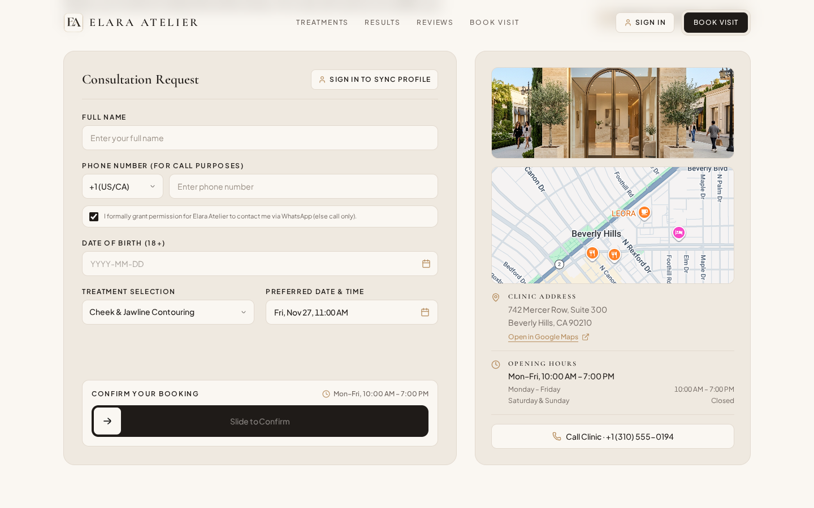
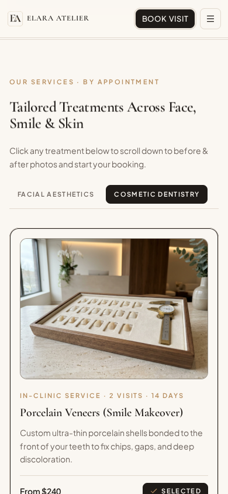
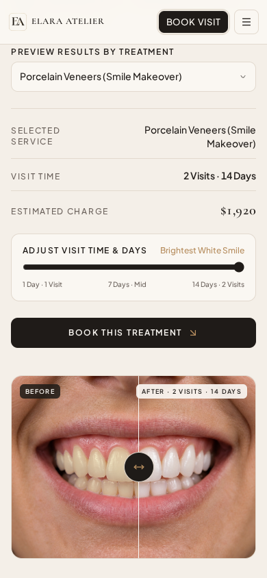
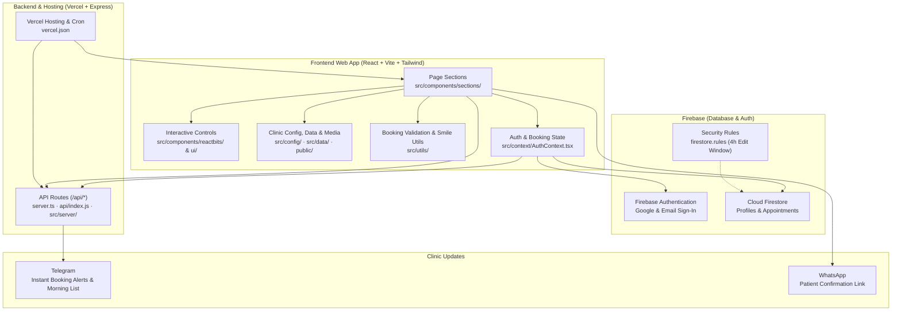

# Elara Atelier — Aesthetic & Dental Studio

> A full-stack (frontend + backend) demo studio web application built for portfolio purposes—featuring non-surgical facial treatments, cosmetic dentistry, and skin renewal with React, TypeScript, Tailwind CSS, Express, Firebase, and automated Telegram booking notifications.

[](https://aistudio.google.com/apps/4a09f8e6-265b-4cf0-bd8d-dfa42d7b8f03?showPreview=true&showAssistant=true)

---

## About This Project

**Elara Atelier — Aesthetic & Dental Studio** is a **frontend-cum-backend demo site created for portfolio purposes**. It demonstrates how a luxury appointment-based business can combine an editorial, mobile-responsive customer interface with real full-stack infrastructure:

- **Frontend Showcase**: Editorial hero, filterable treatment catalog, interactive before-and-after comparison slider, customizable Porcelain Veneers timeline & pricing preview, weekday-only booking calendar, and a Patient Profile portal with quick-book popups and past-booking archives.
- **Backend & Database**: Express serverless API (`/api/*`) paired with **Firebase Authentication** and **Cloud Firestore** (including security rules enforcing a 4-hour patient edit/cancel window) plus real-time **Telegram** booking/cancellation updates and automated daily schedule PDFs.
- **Sample Portfolio Data**: All treatments, studio addresses, pricing estimates, and reviews are sample demonstration content crafted specifically for this portfolio showcase.

👉 **[Open Project Workspace Directly](https://aistudio.google.com/apps/4a09f8e6-265b-4cf0-bd8d-dfa42d7b8f03?showPreview=true&showAssistant=true)**

---

## Preview

### Studio Hero & Welcome
Warm, minimal editorial layout with serif display typography (`Cormorant Garamond`), interactive service preview cards across Facial Aesthetics, Cosmetic Dentistry, and Skin Renewal, and quick navigation to treatments and appointment booking.


### Treatment Catalog
Filterable service categories across **Facial Aesthetics**, **Cosmetic Dentistry**, and **Skin Renewal**. Clicking any treatment smoothly scrolls down to the interactive before-and-after preview and pre-selects that service for booking.


### Interactive Before & After Preview
Drag-to-compare results across treatments—including the **Porcelain Veneers (Smile Makeover)** preview with an interactive **Visit Time & Days** slider (`1 Day · 1 Visit` to `14 Days · 2 Visits`), live estimated charge updates, and a direct **Book This Treatment** handoff.


### Consultation Request & Studio Map
Simple phone-first booking with adult (18+) date-of-birth verification, weekday-only scheduling that blocks past dates, optional WhatsApp contact permission, slide-to-confirm booking submission, and an interactive clinic map.



### Mobile Responsive Experience
Adapts cleanly from compact mobile screens to desktop displays with an unclipped mobile navigation bar, stacked layouts, and touch-friendly controls across every step of the patient journey.

| Studio Hero & Welcome | Treatment Catalog | Interactive Before & After Preview | Consultation Request & Studio Map |
| :---: | :---: | :---: | :---: |
|  |  |  |  |

---

## Key Features

- **Treatment Discovery & Previews**: Browse services across Facial Aesthetics, Cosmetic Dentistry, and Skin Renewal, compare before-and-after results interactively, and jump straight into booking with your chosen service pre-selected.
- **Smart Consultation Booking**:
  - Clean single-phone booking flow with country-code selection and explicit WhatsApp contact consent (defaults to WhatsApp permission; switches to phone-call-only if unchecked).
  - Built-in calendar picker enforcing studio hours (Monday–Friday, 10:00 AM – 7:00 PM), blocking past calendar dates, and verifying 18+ patient eligibility.
  - Slide-to-confirm submission to prevent accidental requests, with instant WhatsApp confirmation handoff.
- **Patient Portal & Calendar**:
  - Sign in with Google or Email/Password powered by **Firebase Authentication**.
  - Patient profiles and appointments are stored securely in **Firebase Cloud Firestore**.
  - Signed-in patients can view their monthly visit calendar and edit or cancel bookings within a 4-hour post-booking window.
- **Clinic Notifications**:
  - Whenever a new booking is made, updates (including treatment details and starting cost) are automatically pushed to **Telegram** so the clinic team is notified immediately.
  - On mornings with scheduled appointments, a single daily booking list is pushed to Telegram (skipped automatically on days with zero bookings).
- **Legal & Trust Pages**: Includes dedicated Privacy Policy and Terms & Conditions pages detailing Firebase data storage and Vercel hosting.

---

## Tech Stack

| Layer | Technology |
| :--- | :--- |
| **Frontend** | React 19, TypeScript, Vite, Tailwind CSS v4, Motion (`motion/react`), Lucide Icons |
| **Backend API** | Express (`src/server/createApp.ts`) running on Node locally (`server.ts`) and Vercel Serverless (`api/index.js`) |
| **Database & Auth** | Firebase Authentication (Google + Email/Password) & Cloud Firestore |
| **Notifications** | Telegram booking alerts & WhatsApp confirmation links |
| **Hosting** | Vercel (`vercel.json`) |

---

## Project Structure & Data Flow



---

## Local Development

### Prerequisites
- Node.js `>= 20`
- npm `>= 10`

### 1. Install Dependencies
```bash
npm install
```

### 2. Configure Environment Variables
Copy `.env.example` to `.env` and add your local settings:

```bash
cp .env.example .env
```

Firebase configuration is loaded from `firebase-applet-config.json`. To enable Telegram booking notifications, provide your Telegram credentials in `.env` (the website and Firebase booking flow continue to work cleanly even when Telegram credentials are omitted).

### 3. Start the Dev Server
Runs both the Vite frontend and Express API on port `3000`:

```bash
npm run dev
```

Visit `http://localhost:3000`.

### 4. Build, Lint & Test
```bash
npm run lint
npm run build
npx --yes tsx --test src/utils/booking.test.ts src/server/teamTelegramBot.test.ts firestore.rules.test.ts
```

---

## Deployment (Vercel)

This project is pre-configured for **Vercel** via `vercel.json`:
1. Push your repository to GitHub and import it at [vercel.com/new](https://vercel.com/new).
2. Add your environment variables in **Vercel Project Settings → Environment Variables** (`APP_URL` and optional Telegram notification variables).
3. Add your production Vercel domain under **Firebase Console → Authentication → Settings → Authorized domains** so Google Sign-In works seamlessly in production.
4. Deploy—Vercel builds the static frontend into `dist/` and routes `/api/*` requests through `api/index.js`.
